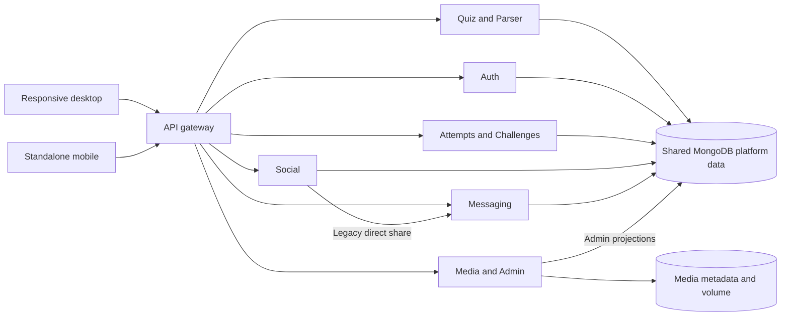

# QuizFocus current state

**Audit date:** 7 November 2026. **Git baseline:** `main`, `70e285e` (`seperating css files and more`). The Git root is `mcq-platform/` within the outer `mcq/` workspace. The checkout already held staged and unstaged changes across both the UI and services, staged documentation moves and upload deletions, and untracked media. Preserve that work when reviewing the diff. No reset, database migration, or deployment formed part of this pass.

The outer workspace holds `.agents/`, `docs/`, an extractor utility, and scripts. The four README entry points are the platform README, its docs pointer, the outer docs index, and the extractor README. The extractor's SQLite database is separate from the application. [Repository source inventory](../repository-inventory.json) records the initial file survey and exact duplicate source groups. The audit inspected service entry points, routes, schemas, configuration, client integration, and regression tests. A final syntax pass parsed 581 JavaScript and TypeScript source files. Inventory coverage is broader than the code paths exercised end to end.

| Service | Path under `services/` | Responsibility | Example port | Dependencies and boundary | Step 01 state |
|---|---|---|---|---|---|
| API gateway | `api-gateway` | Public REST, static route and Socket.IO proxy | 5000 | Nine service URLs, configured browser origins | Verified on isolated stack. Fixed readiness, request ID, proxy deadline and forwarded IP handling |
| Auth | `auth-service` | Accounts, cookies, profiles, preferences, follows | 5001 | MongoDB, JWT access and refresh secrets | Verified registration, preference updates and revocation. One stored refresh token per account |
| Quiz | `quiz-service` | Authoring, publication, quiz search and question reads | 5002 | MongoDB, parser URL and local cache | Regression suite passes. Shared models and legacy challenge logic remain |
| Parser | `parser-service` | Uploads, spreadsheet parsing, column mapping | 5003 | MongoDB, XLSX/CSV parsers, temporary files | Readiness verified. Malicious archive and dependency review remains |
| Attempt | `attempt-service` | Attempts, timing, scoring and result access | 5004 | MongoDB quizzes, questions and challenges | Existing regression suite exercised. Concurrent cutoff and finalization need dedicated tests |
| Social | `social-service` | Feed, interactions, follows, comments, notifications | 5005 | Shared MongoDB, Message Service for legacy direct share | Privacy and routing exercised. Shared reads and duplicated schemas remain |
| Messaging | `message-service` | DM membership, writes, history, unread state and events | 5006 | MongoDB, shared user/follow/quiz projections, Socket.IO | Verified HTTP and WebSocket paths. Presence and rate budgets remain process local |
| Media | `media-service` | Image processing, variants and delivery | 5007 | MongoDB media metadata, Sharp, filesystem storage | Readiness and three media tests. Shared storage required for replicas |
| Admin | `admin-service` | RBAC, reports, audit and service health | 5008 | Primary and optional separate auth/quiz/attempt MongoDB connections, service health URLs | Readiness and report submission exercised. Privileged paths need broader audit |
| Challenge | `challenge-service` | Contest authoring, deadlines, quarantine and rankings | 5009 | MongoDB and shared question/attempt data | Readiness and existing route tests. No contest policy changed in Step 01 |

Ports above come from service templates and Compose. Verification reserved different loopback ports and used local MongoDB 9.0, with the database isolated from application settings. On the initial host check, no app gateway or MongoDB listener was available. The initial `npm test` tried port 5000 and its API checks failed to connect. Previous handoffs and pass counts are historical. There are no root lint or type-check scripts and no tracked CI workflow in the audited baseline.

| Client | Path | Installed stack | Routes and state |
|---|---|---|---|
| Responsive desktop | `apps/desktop-web` | React 18.3.1, Vite 5.4.21, Axios 1.16.0, Zustand 4.5.7, Socket.IO client 4.8.4, Framer Motion, Tailwind | `AppRouter`, `/messages`, `/messages/:conversationId`, `/settings/*`, `/admin/*`. Auth, UI, preferences and quiz stores |
| Standalone mobile | `apps/mobile-web` | React 18.3.1, Vite 5.4.21, Axios 1.20.0, Zustand 4.5.7, Socket.IO client 4.8.4 | `MobileRouter`, separate auth and quiz stores, inbox/thread routes and mobile shell |

All installed backends use Express 4.22.3 and `proxy-addr` 2.0.8. Domain services use Mongoose 8.24.5 or 8.24.7 and `jsonwebtoken` 9.0.3. The gateway uses `http-proxy-middleware` 3.0.7. Chat uses existing Socket.IO 4.8.4. Local verification used Node 20.11.1, which is outside upstream support. Use a supported LTS for production after validating builds and native dependencies. [Node.js support dates](https://nodejs.org/en/about/eol)

The gateway maps `/api/v1/auth`, `/users`, `/quiz`, `/quizzes`, `/search`, `/upload`, `/parser`, `/attempts`, `/social`, `/notifications`, `/messages`, `/media`, `/admin` and `/challenges`, all under `/api/v1`. Attempt aliases match before quiz routes. `/socket.io` supports polling and upgrade. `/media` and `/uploads` serve media paths. See `services/api-gateway/src/server.js` for the exact mounts.

The services deploy separately but read the same platform collections. Copies of models, auth middleware, upload helpers, and timer/scoring code can drift. The gateway even contains unused-looking model copies. There is no shared domain package. Quiz has a parser URL and Admin calls gateway and service health. Gateway calls the Admin health endpoint, which is local to Admin, so that probe has no recursive request. The audit did not establish the absence of every possible service dependency cycle.

Compose starts a local MongoDB 7 instance and ten backend processes. The desktop Vercel config supplies SPA rewrites. A production ingress still needs API and WebSocket routing and persistent storage. Per-service `.env.example` files are the configuration reference. The root orchestrator starts local services from their own `.env` files. This pass adds `.dockerignore` to keep real `.env` files, host dependencies and runtime media out of images.

## `.agents` reconciliation

The design rules remain active. `.agents/teamwork/PROJECT.md` still lists planned or in-progress milestones even though `SettingsMenu`, polymorphic `QuizCard`, challenge service wiring and competition routes exist. Treat those entries as historical and verify behavior against code. The handoff's claims of zero fake data and full completion did not match the direct-share fallback, incomplete chat history, and misleading health checks found in this checkout. The dedicated mobile client and competition service exist, while group chat, durable finalization, shared socket infrastructure, comprehensive mobile QA, and several operational safeguards remain open. [Risks](05-security-and-risk-register.md) · [Verification](07-step-01-verification-report.md)
