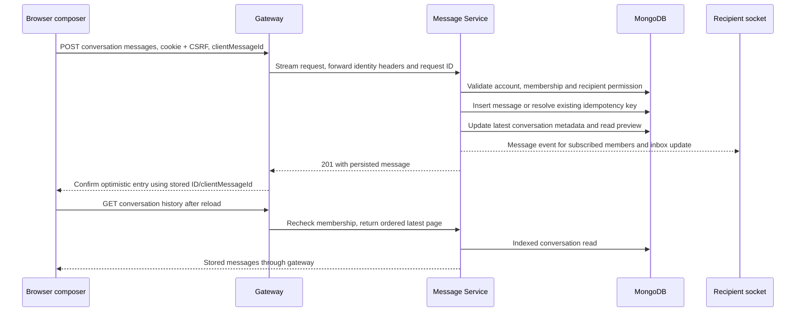

# Messaging inventory and lifecycle

`message-service/src/controllers/message.controller.js` handles HTTP shapes, `services/messaging.service.js` owns domain operations, and `services/messagePolicy.js` validates IDs, content, visibility, cursor order and edit limits. `socket/socketHandler.js` invokes the same domain operations. JWT and CSRF middleware sit before the routes. `social-service` delegates its legacy quiz direct-share POST to Messaging. Clients use local API and socket wrappers, with the gateway as their common entry point.

| Capability | Stored or runtime representation | Status |
|---|---|---|
| Conversation | `conversations.participants` references users. `lastMessage`, `lastMessageAt` and `lastMessageText` are preview metadata. New direct threads have a sorted `directKey` | Concurrent starts verified. Existing thread IDs are retained |
| Message | `messages` holds conversation and sender ObjectIds, `text`, `type`, timestamps, and optional reference metadata | REST and socket sends persist through the same code |
| Order and pages | `(conversation, createdAt DESC, _id DESC)` index. Latest page returned in chronological order. `before`/`after` use a visible message as cursor | Same timestamp boundaries and foreign cursors tested |
| Retries | Optional `clientMessageId` and partial unique `(sender, clientMessageId)` index | Concurrent retries return one stored message. Legacy requests can omit the key |
| Read and unread | Stored `readBy` supports recipient counts, while `deliveryStatus` and receipt events reflect consent. Read accepts up to 200 IDs | Private reads decrement unread without publishing a receipt |
| Edit, react and delete | Sender-only edits within 15 minutes, atomic per-user reaction update, personal hides via `deletedFor`, shared tombstones via `isDeleted` | Shared deletion clears attachments and quote snapshots. Personal hide is sent only to that account's sockets |
| Privacy | `preferences.allowMessagesFrom` (`everyone`, `followers`, `following`, `none`) and read/typing controls. Server checks active account and membership | HTTP and socket denial tested. Dedicated block lists and abuse reporting for DMs remain incomplete |
| Content references | Public and unlisted quiz/comment previews and validated HTTP(S) or relative URLs. Existing schema can store media metadata | Private, restricted and draft previews are blocked. Media and challenge authorization remain with their source domains |
| Live features | Personal socket room and authorized conversation rooms, scoped presence, typing, receipts, reactions and edits | Single-process delivery. REST is the durable source of truth |
| Groups, pins, mute, archive | Schema has group/pin/mute fields. No supported group membership or archive API | Incomplete or proposed only |

If confirmation fails, the desktop composer restores its draft and retries with the same key for the same payload. Mobile reconciles the same key during its active session. UI pending state is separate from a persisted message. Client keys are deduplication hints, while the server determines the sender from authentication. Delivery events can arrive before HTTP returns and merge with the confirmed row. Reconnect rejoins and reloads recent history. Missed older edits during disconnection and durable event replay remain follow-up work.

## Query and consistency findings

The participant index supports membership and the participant/activity index supports inbox sorting. Personal hides require separate preview visibility, so inbox listing still performs a bounded latest-message lookup per conversation. Counts aggregate message rows and avoid lost counter increments, but high-volume threads will need a better read model. Search is a literal escaped substring scoped to the thread, with bounded results and a query deadline. It can still scan a long thread. Presence keeps a capped process-local last-seen map. No TTL deletes chat history. Message rows have fixed text and metadata bounds, while participant, reaction and read arrays suit direct messages more than large groups.

The message insert and preview update are separate MongoDB operations. On partial failure after a successful insert, the stored row remains authoritative and is returned to the sender. The inbox looks up the actual last visible message. The conversation activity sort can lag and a socket notification can be missed. A future repair worker or durable outbox should handle this explicitly. `npm run db:check` reports index metadata and duplicate direct-pair counts without printing message content or modifying records.
