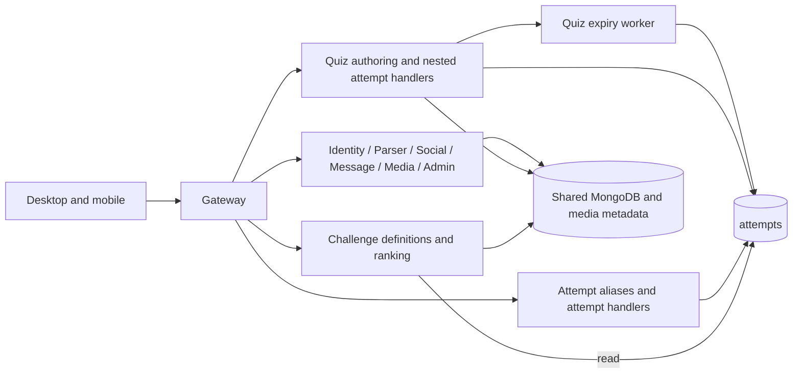
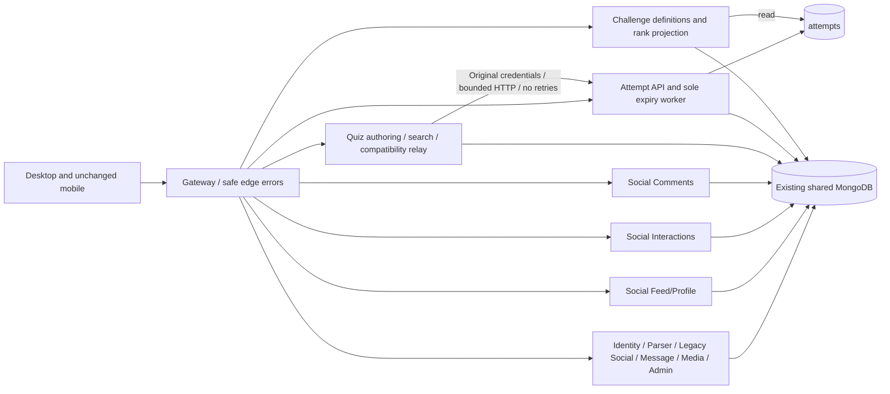
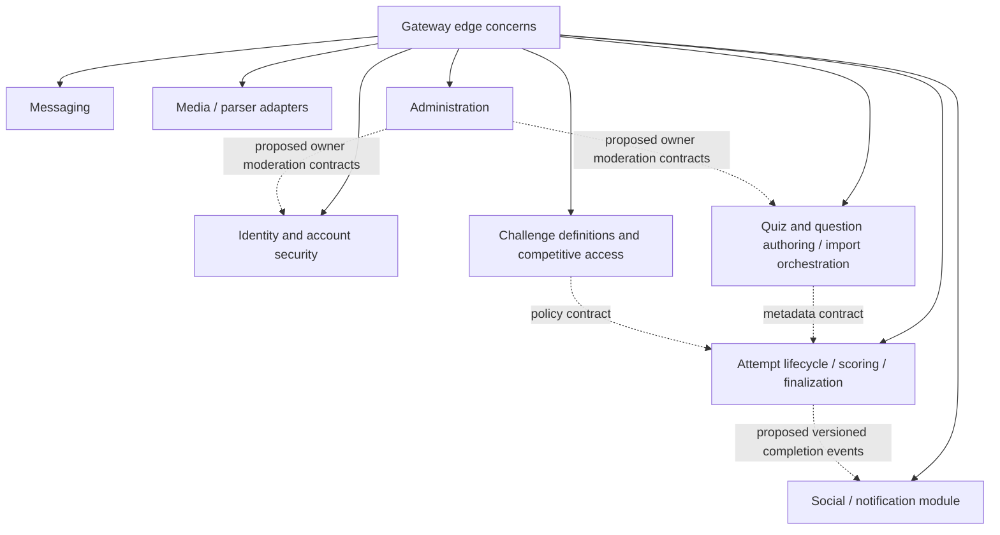

# Step 02 service boundaries

Reviewed November 8, 2026 in the existing dirty `main` checkout based on `70e285e`. Step 01 evidence exists in [01](01-current-state-audit.md), [05](05-security-and-risk-register.md), [06](06-migration-roadmap.md) and [07](07-step-01-verification-report.md). Its Step 02 handoff focused on messaging. The new user brief supersedes that sequencing with application architecture work. Staging backups, capacity measurements and production rollout prerequisites remain unverified. Implementation and tests use disposable local data.

The runtime has thirteen independently runnable Express processes, two React/Vite clients, shared MongoDB collections, filesystem media and in-process timers. Compose defines deployment units, not evidence that they are deployed in production. There is no broker, dedicated search cluster or separately deployed worker. The outer extractor's SQLite database is a different application.

| Component | Directory | Owner and public API under `/api/v1` | Runtime dependencies | Data authority and exceptions | Deployment evidence |
|---|---|---|---|---|---|
| Gateway | `services/api-gateway` | Edge routing, `/health`, `/livez`, `/readyz`, all domain proxies | Twelve HTTP services, Message Socket.IO | No application data. Fourteen copied model files are unused by the server graph | Dockerfile, Compose port 5000 |
| Identity | `services/auth-service` | Accounts, sessions and preferences, `/auth`, `/users` | MongoDB, JWT signing and verification | Users. Legacy follow/profile aliases also write/read Social data | Dockerfile, Compose internal 5001 |
| Quiz | `services/quiz-service` | Authoring, questions, publish, `/quiz`, `/quizzes`, `/search` | MongoDB, local cache, Attempt HTTP relay | Quiz/question content. Legacy challenge authoring, user counters and import projections remain exceptions | Dockerfile, Compose internal 5002 |
| Parser | `services/parser-service` | Structured upload, parse, mapping, `/upload`, `/parser`, `/uploads` | MongoDB, XLSX/PapaParse, filesystem | Upload parse state and mapping. Reads shared quiz duplicates | Dockerfile, Compose internal 5003 |
| Attempt | `services/attempt-service` | Attempt state, timing, scoring, `/attempts`, attempt aliases under `/quiz` | MongoDB, in-process finalizer | Sole routed attempt mutation/finalization authority. Writes derived quiz aggregates and activity/notification records as compatibility exceptions | Dockerfile, Compose internal 5004 |
| Social compatibility | `services/social-service` | Legacy `/social` fallback and shared Social implementation | MongoDB, Message HTTP for direct-share alias | Original controllers/models remain as transitional implementation; keep until fallback and admin compatibility consumers are migrated | Dockerfile, Compose internal 5005 |
| Social feed/profile | `services/social-feed-service` | Feed, explore, profiles, follows, activity, notifications | MongoDB, shared Social implementation source | Reads/writes profile/follow/activity/notification records and existing counters | Dockerfile, Compose internal 5010 |
| Social interactions | `services/social-interactions-service` | Bookmarks, quiz likes, shares and contacts | MongoDB, Message HTTP for direct-share alias | Writes interaction/share records and existing quiz counters | Dockerfile, Compose internal 5011 |
| Social comments | `services/social-comments-service` | Comment list/create/edit/delete and comment likes | MongoDB, shared Social implementation source | Writes comments and existing quiz/user counters plus activity/notifications | Dockerfile, Compose internal 5012 |
| Messaging | `services/message-service` | DMs, `/messages`, `/socket.io` | MongoDB, process-local Socket.IO | Conversations and messages. Reads user/follow/content projections and updates share counts | Dockerfile, Compose internal 5006 |
| Media | `services/media-service` | Image validation, variants and delivery, `/media` | MongoDB, Sharp, filesystem | MediaAsset and image variants. Asset delivery authorization needs Step 13 review | Dockerfile, Compose internal 5007 |
| Administration | `services/admin-service` | RBAC, moderation, reports, audits, `/admin` | Main DB, optional auth/quiz/attempt DB connections, service health HTTP | RBAC, reports, audit. Raw cross-domain account/content moderation writes remain explicit exceptions | Dockerfile, Compose internal 5008 |
| Challenge | `services/challenge-service` | Competitive definitions, publication, discovery, ranks, `/challenges` | MongoDB shared quiz/question/attempt projections, local rank cache | Challenge definition fields in `quizzes`; questions in shared collection. Reads attempts, excludes creator practice from ranking | Dockerfile, Compose internal 5009 |
| Desktop frontend | `apps/desktop-web` | Responsive React UI | Same-origin gateway HTTP and Socket.IO | Local drafts/UI state only; server owns accounts/content/results | Vite, Vercel SPA configuration |
| Mobile frontend | `apps/mobile-web` | Standalone React UI | Same-origin gateway HTTP and Socket.IO | Separate client state | Vite/Vercel. Source unchanged by user instruction |

Observed installed versions include React 18.3.1, Vite 5.4.21, Express 4.22.3, gateway proxy middleware 3.0.7 and Attempt Mongoose 8.24.5. Desktop Axios is 1.16.0, mobile Axios 1.20.0. No dependency or runtime upgrade is included here. Installed Node 20.11.1 remains a release risk from Step 01.

## Before the selected changes

## Resulting running architecture

Quiz's old attempt controller functions remain as unmounted legacy code. They are not imported into the active quiz router. They and unused copied application/domain modules should be removed only after reference and compatibility checks in Step 06. The source inventory deliberately includes them and must not be read as a runtime call graph.

## Target logical domains

Dashed edges are proposed contracts, not deployed event infrastructure. Keep question banks in Quiz, notifications in Social, discovery in its current services, and media/parsing as distinct workloads. No new deployment boundary has demonstrated a scaling or ownership need. Retain MongoDB and stable ObjectIds. Logical ownership will be enforced incrementally before separate database credentials or databases are introduced.

## Confirmed problems and selected response

| Evidence | Problem | Step 02 disposition |
|---|---|---|
| Quiz and Attempt route files both bound start/sync/submit; Quiz cleanup worker wrote attempts | Competing attempt authority | Quiz routes now relay; finalizer now belongs to Attempt |
| Desktop `AttemptService.syncAttemptState` used submit URL | Saving progress could finalize an attempt | Uses explicit `/sync-progress`; executable client transport test added |
| Admin `protectAdmin` accepted `ADMIN_EMAIL` match | Self-registered email could gain wildcard authority | Only persisted admin role or RBAC grants authority; real denial/success tests |
| Attempt's Quiz schema lacked `isRestricted`; Quiz detail cache returned before policy read | Moderation changes bypassed read/access policy in another process | Additive projection field, fresh detail policy reads, corrected discovery filters and integration test |
| Duplicated `models`, tracking, scoring and auth files across services | Schema and policy drift; inventory source writes include dormant code | Source evidence recorded; remove dormant copies and add owner APIs in Steps 03/04/06/07 |
| Auth `/users/:username/follow` and Social follow APIs | Two relationship writers and counters | Preserve aliases; migrate Identity aliases to Social with parity tests in Step 08 |
| Admin raw collection access; local caches; process-local presence | Shared mutation and consistency assumptions | Explicit exceptions and future contracts in [13](13-service-communication.md) and [14](14-database-ownership.md) |

Generate reproducible source evidence with `node scripts/architecture-inventory.mjs`. [Inventory JSON](architecture-inventory.json) records models, operations, route registrations, network references and timers. Detection is a lower bound and does not prove that every exported function is reachable.

## Social deployment split (2026-11-09)

The Gateway preserves `/api/v1/social/*` and routes feed/profile/relationships/notifications to `social-feed-service`, quiz bookmarks/likes/shares to `social-interactions-service`, and comment operations to `social-comments-service`. `/api/v1/notifications/*` remains an alias to feed/profile. Unclassified Social routes use the old Social service as a temporary compatibility fallback. The three services have separate entry points, ports, Docker images, Compose services and local verification-stack entries.

This is a **deployment and route ownership split, not database or implementation ownership isolation**. Domain handlers are currently re-exported from the legacy Social source tree, and the processes connect to the existing shared MongoDB and schemas. The old service remains required by the fallback and Admin's `SOCIAL_SERVICE_URL` setting. Keep it until route coverage, consumers and compatibility tests justify removal. Next, extract each controller and its exclusive helpers/models into its owning service, then introduce explicit write ownership for shared counters, activity and notifications before considering separate credentials/databases. No collection migration or user-data rewrite is part of this change.
