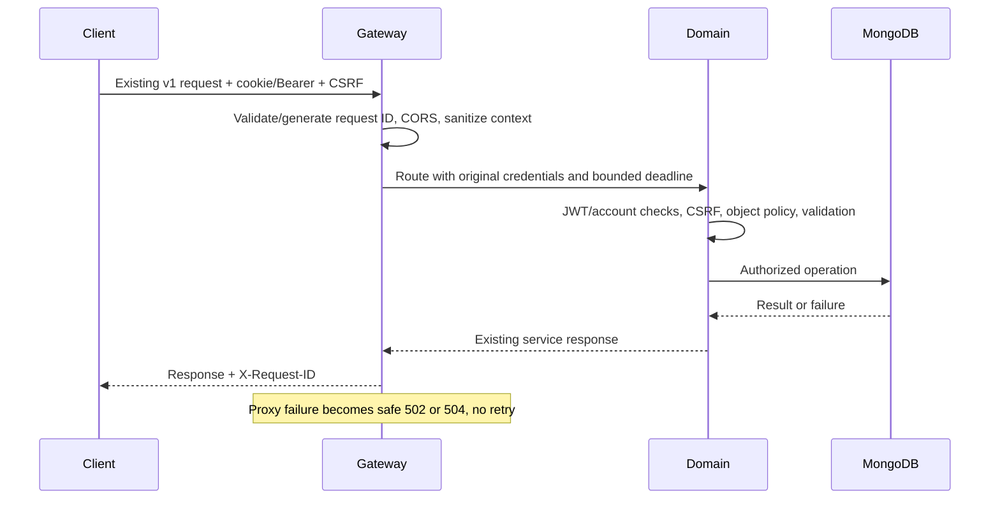
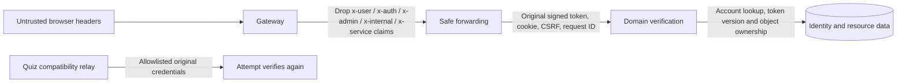

# Gateway and authentication propagation

The gateway remains an HTTP/Socket.IO edge proxy. It has no database connection or domain policy ownership. `src/contracts.js` classifies edge failures and strips misleading client identity headers. `src/runtime.js` owns request IDs, configuration primitives and cached readiness probes. This is a selective internal refactor, not a new shared runtime package.

## Route contract

All paths below keep their existing methods and payloads. Mount order is significant.

| External path | Destination |
|---|---|
| `/api/v1/quiz/attempts/*`, `/api/v1/attempts/*` | Attempt, before generic Quiz mount |
| `/api/v1/auth/*`, `/api/v1/users/*` | Identity |
| `/api/v1/quiz/*`, `/api/v1/quizzes/*`, `/api/v1/search/*` | Quiz. Nested `/quiz/:id/attempt...` relays to Attempt |
| `/api/v1/upload/*`, `/api/v1/parser/*`, `/uploads/*` | Parser, except `/uploads/covers/*` to Quiz |
| `/api/v1/media/*`, `/media/*` | Media |
| `/api/v1/social/*` | Social |
| `/api/v1/notifications/*` | Social `/api/v1/social/notifications/*` |
| `/api/v1/messages/*`, `/socket.io` | Message HTTP/polling/WS |
| `/api/v1/admin/*` | Admin |
| `/api/v1/challenges/*` | Challenge |



## Trust model



The gateway injects no trusted user ID or role. A request ID is correlation data, not an authentication assertion. Guest-session headers identify a bearer-like guest session, not a registered user or role. Possession and confidentiality of guest session IDs remain important. End-service verification is retained on direct service paths and internal relays. Shared signing keys and shared account reads are current trust assumptions, not service identity or mTLS.

CORS origin allowlisting and Helmet remain in place. Credentialed requests use existing cookies and CSRF headers. JSON/body/upload limits remain domain-specific, including 32 KiB message payloads and separate multipart limits. The gateway streams payloads and does not parse or duplicate all uploads. Global edge traffic quotas and a unified upload ceiling remain Step 19 work. Set `TRUST_PROXY_HOPS` only for the actual ingress topology. Domain ports must remain private; Compose uses `expose`, with only the gateway publicly mapped.

## Error compatibility

Gateway-generated errors add a structured field while keeping `success`, `message` and `data`.

```json
{"success":false,"message":"Downstream service unavailable","data":null,"error":{"code":"DEPENDENCY_UNAVAILABLE","message":"Downstream service unavailable"},"requestId":"request-123"}
```

| Status | Code | Meaning |
|---|---|---|
| 400 | VALIDATION_ERROR | Invalid request |
| 401 | UNAUTHENTICATED | Authentication required |
| 403 | FORBIDDEN | Denied operation |
| 404 | RESOURCE_NOT_FOUND | Unknown gateway path |
| 409 | STATE_CONFLICT | Conflicting state |
| 413 | PAYLOAD_TOO_LARGE | Request exceeds limit |
| 429 | RATE_LIMITED | Traffic limit |
| 502 | DEPENDENCY_UNAVAILABLE | Connection/upstream failure |
| 503 | SERVICE_UNAVAILABLE | Draining/unavailable service |
| 504 | DEPENDENCY_TIMEOUT | Upstream exceeded deadline |
| 500 | INTERNAL_ERROR | Unexpected gateway failure |

The mapping utility does not imply every status is generated by the gateway today. Successful downstream responses and downstream error envelopes pass through unchanged. Existing domain services have different envelopes and are not silently normalized by a proxy response buffer. Clients must accept both formats. [JSON Schema](../../contracts/http-error.v1.schema.json) describes the new edge envelope. No stack traces, origin URLs or original exception messages are returned in these edge failures in any runtime mode.

`PROXY_TIMEOUT_MS` defaults to 30 seconds. Proxy timeout now returns 504; refusal remains 502. Incoming request timeout allows five extra seconds. `/livez` is process liveness; `/readyz` reports all dependencies with a short collapsed-probe cache. Readiness degradation does not automatically block healthy unrelated routes. Client disconnects are handled by proxy transport; Quiz's relay also aborts when its response connection closes. Fault tests cover refusal, bounded upstream stall and relay cancellation. Half-open sockets, ingress faults and production draining need staging tests.
