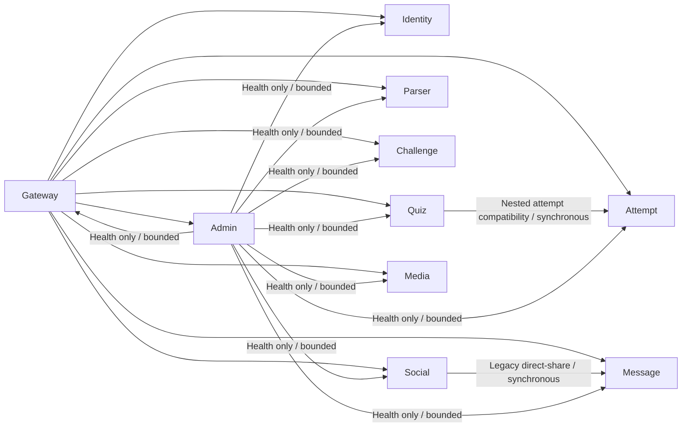
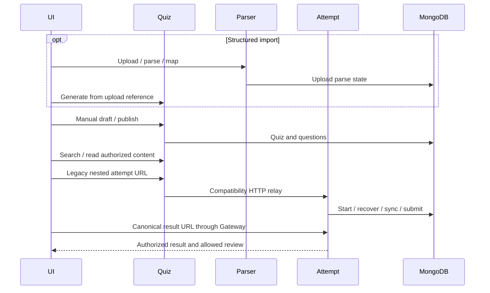
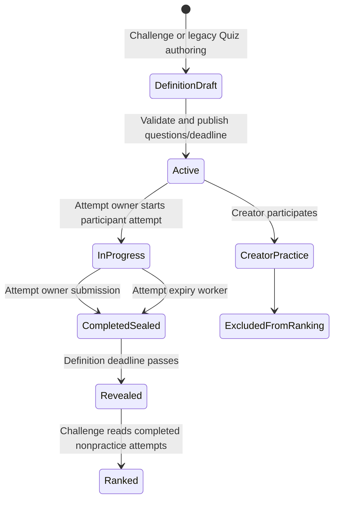
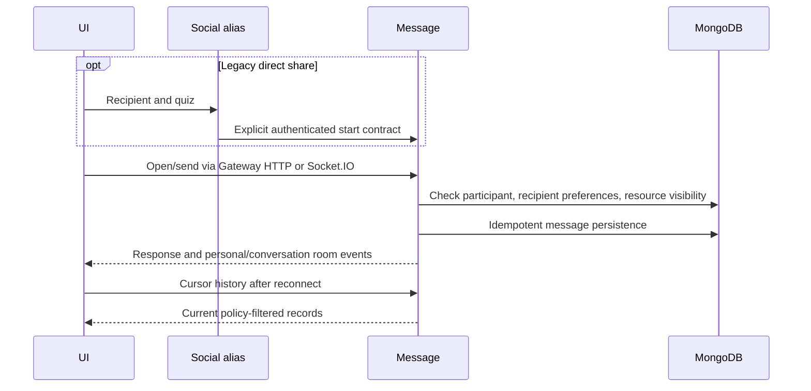

# Service communication and workflows

## Actual HTTP dependencies after Step 02

The Gateway/Admin graph has a monitoring cycle, but gateway probes Admin's basic DB health, not Admin's aggregate `/system/health` endpoint. There is no recursive health call along the implemented path. Quiz's parser URL is configuration, not evidence of a live HTTP call. Parser state is consumed through shared records in the current generation flow. No private cross-service source import was introduced.

| Caller → target | Operation and credentials | Request → response contract | Deadline and failure | Retry |
|---|---|---|---|---|
| Client → Gateway → domains | Existing public v1 API, cookie/Bearer and CSRF | Domain-specific existing JSON/multipart contracts | Gateway 30s default, 502 refusal, 504 timeout | No automatic proxy write retries |
| Quiz → Attempt | Existing nested attempt URLs, original allowlisted credentials and guest-session header | Same method/path/body; `{success,data}` and existing errors forwarded | 15s default, configurable 100–30000ms; 503 unavailable, 504 timeout. Reject redirects/malformed JSON contract, abort on disconnect | None, including POST/PUT |
| Social → Message | `/messages/start`, original cookie/Bearer, CSRF and request ID | Recipient ID/username, optional initial text and quiz ID → legacy `{conversationId,messageId}` | Existing 10s abort, unavailable 503 | None; caller may supply `clientMessageId` |
| Admin → service health | Basic `/health` reads, no user impersonation | `{status}` projected to service/latency/result | Configured health deadline; report unavailable dependency | Next explicit probe only |
| Message → browser | Authorized Socket.IO rooms | Existing `message:new`, edits/deletion/reactions/read/typing/presence events | Token expiry/revocation, per-event budgets, reconnect reload | Text retries use sender/client-ID dedupe |

Quiz relay validates the configured origin, permits only HTTP(S) origins without credentials/query/path, forwards an explicit header allowlist and never forwards client role/internal-service claims. Receiving Attempt Service validates the original token and object ownership. There is no privileged unauthenticated internal API or new machine credential. This preserves the existing network trust model; service identity/key separation belongs to Step 03.

## Quiz lifecycle

All network calls in these diagrams pass through the gateway for browser clients. Parser→Quiz state transfer currently uses shared MongoDB records, not an implemented event. Import archive/security and the entire upload→mapping journey remain Step 06 validation work.

## Challenge lifecycle

The existing cap, timer limit, quarantine and creator-practice rule remain. Attempt is the execution owner; Challenge is the definition and ranking-view owner. The test moves only disposable deadline metadata to the past and invokes the real Attempt finalizer, then verifies ranking excludes practice. It does not prove deadline races or replica fencing. Single-winner atomic transitions and durable scheduled execution remain Step 07/18 requirements.

## Messaging request flow

## Consistency and future events

| Workflow | Authority | Current consistency | Required replacement |
|---|---|---|---|
| Publication → discovery | Quiz, Challenge definitions | Direct shared reads plus local projections | Versioned metadata/read contract; later event-driven projection |
| Attempt → counters/activity/notifications | Attempt state, Social delivery module | Some direct cross-domain derived writes; no reliable outbox | `attempt.completed.v1` with immutable event ID, attempt/quiz/actor IDs and occurredAt |
| Follow → feed/counters | Social | Auth aliases still write same relationship data | Social owner API adapter, dedupe and reconciliation |
| Moderation → content reads/shares | Admin intent; content owner policy | Admin writes raw flag. Selected detail/discovery/attempt reads now re-check it | Owner moderation API and revisioned content-visibility invalidation |
| Content deletion → messages | Quiz/Challenge content, Message records | Policy-filtered share previews; stale quoted snapshots require lifecycle review | Versioned revoke event, idempotent consumers, bounded reconciliation |
| Account restriction → chat | Identity account status | Fresh HTTP/event checks, socket expiry; passive room-delivery eviction remains open | Account policy event plus disconnect/room eviction and reconciliation |

For Step 18, persist owner state plus outbox atomically where supported, version schemas, retain delivery IDs, bound retry attempts with backoff, record dead-letter reason without content/secrets, and provide replay/reconciliation tools. No message broker, distributed transaction, retry daemon or reliable event delivery has been added. Failure after an attempt save but before derived activity/counters is a known partial-success window.
