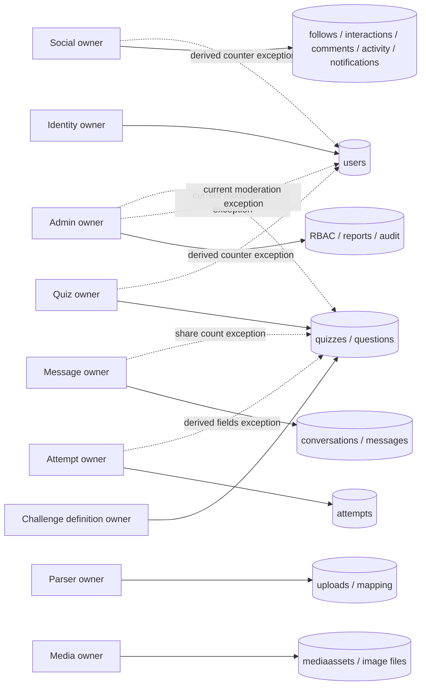

# Database ownership and access exceptions

Existing MongoDB databases, collections, identifiers and records are preserved. Authority below is logical; current service credentials generally permit shared collection access. Splitting ownership does not require another cluster. Production size/index/credential evidence is absent. The verifier creates and removes only its own temporary database directory.

| Collection/model | Authoritative destination owner | Verified active readers | Current writers and exceptions | Replacement boundary |
|---|---|---|---|---|
| `users` / User | Identity | Identity, Quiz, Attempt, Parser auth, Social, Message, Challenge, Admin; Media auth | Identity account writes; Social counters, content counters, Admin restrictions/roles; several legacy auth middleware user-code backfills. Attempt's backfill removed | Identity lookup projection, account-state policy, counter commands/events |
| `quizzes` / Quiz and Challenge | Quiz content; Challenge competitive definition fields | Quiz, Attempt, Challenge, Social, Message, Parser duplicate lookup, Identity profile, Admin | Quiz and legacy challenge authoring; Challenge publish/delete; Attempt aggregates and derived ended status; Social/Message interaction/share counts; Admin moderation | Field ownership registry, metadata and moderation APIs, derived aggregate events |
| `questions` / Question | Quiz; Challenge publication adapter | Quiz, Attempt, Challenge | Quiz authoring/import generation, Challenge question publication/deletion, content cleanup | Quiz authoring contract; immutable published snapshot for execution |
| `attempts` / Attempt | Attempt | Attempt, Quiz analytics/content cleanup, Challenge rankings, Social activity, Admin | Attempt API and expiry worker. Quiz content deletion may cascade; old Quiz handlers are unmounted | Retention/delete command owned by Attempt before credentials are narrowed |
| `uploads` / Upload | Parser | Parser; Quiz generation and duplicate checks | Parser validation/parse/mapping; Quiz may mark consumption/cleanup | Import result contract with upload ID, schema version and owner session |
| `mappingconfigs` / MappingConfig | Parser logical import module | Model copies exist; no active model operation found by source scan | No live writer established in this pass | Confirm runtime need before removal or API design |
| `follows` / Follow | Social | Social, Identity profile aliases, Message permission checks | Social follow/unfollow and Identity compatibility follow/unfollow | Social relationship API with Identity aliases retained |
| `activities` / Activity | Social | Social; Identity activity view | Social; publication/attempt helper writes from other domains | Versioned content/attempt events and idempotent consumer |
| `quizinteractions` / QuizInteraction | Social | Social; Quiz projections | Social like/bookmark; cleanup helpers | Social command/read projection |
| `quizcomments` / QuizComment | Social | Social, Message preview authorization | Social comments/reactions/deletion; content cleanup | Social interaction API and revoke events |
| `quizshares` / QuizShare | Social interaction record | Social projections | Social public share, Message direct share and counters | Versioned share event with dedupe |
| `notifications` / Notification | Social notification module | Social API; legacy account/activity views | Social and cross-domain activity helpers | Versioned events/outbox in Step 10/18 |
| `conversations` / Conversation | Message | Message; Social share-contact lookup | Message start/member state; old helper definitions remain copied elsewhere | Owner API; Step 09 membership design |
| `messages` / Message | Message | Message; Social share contacts may use conversation metadata | Message only on active send/edit/delete/reaction/read paths; old direct-write helpers are dormant | Existing owner HTTP/socket contracts |
| `mediaassets` / MediaAsset | Media | Media | Media metadata and file lifecycle | Authorized asset contract and shared storage in Step 13 |
| `adminmemberships` / AdminMembership | Admin | Admin | Admin bootstrap from persisted admin role; provisioning script | Admin-owned RBAC commands and audit |
| `adminroles` / AdminRole | Admin | Admin | Provisioning/seed tooling | Admin role policy, never browser claims |
| `adminauditlogs` / AdminAuditLog | Admin | Admin | Admin privileged actions | Append audit contract and retention |
| `moderationreports` / ModerationReport | Admin | Admin | Report submission and resolution | Admin report contract |

Mongoose collection pluralization is used except Challenge explicitly maps to `quizzes`. There is no second authoritative challenge collection. Collection presence is not proven by a model file. The scan includes dormant copied modules and cannot determine every dynamic repository/document `.save()` or raw Mongo operation. Admin's raw `users`, `quizzes`, `attempts` access is manually included above. Consult [inventory evidence](architecture-inventory.json) before pruning copies.

## Incremental replacement

First remove dormant code with import/route evidence. Then give each live cross-domain operation a stable owner API/event schema and parity test. Shadow-read compare permissions and counts, switch through a compatibility adapter, observe errors and only then remove the old write. Narrow database credentials after all real writers are migrated. Do not deploy read-only roles based on this design table alone.

The selected Step 02 change replaces Quiz attempt writes with a bounded owner API and moves expiry execution. Other exceptions remain visible. No collection rename, backfill, index removal, database split or production migration ran. The existing partial unique challenge-attempt/index policy remains in Attempt; broad concurrent lifecycle and stale-save races require Step 07 work.
