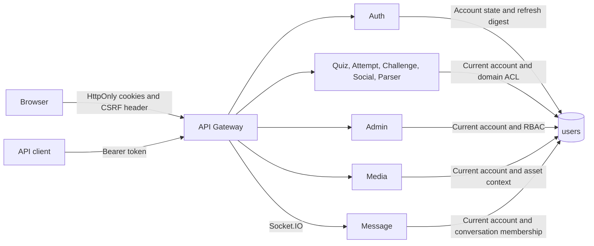

# Identity architecture

QuizFocus uses one MongoDB identity record per account. Auth creates browser sessions and owns credential changes. Each service verifies the credential presented to it and checks current account state. Resource ownership, membership and reveal rules live with the service that handles the request.

| Boundary | Existing authority | Step 03 change |
|---|---|---|
| Auth and desktop | Cookie sessions, bcrypt, explicit account records and authenticated profile settings | Atomic refresh and token-version updates, username login validation, single in-flight desktop refresh |
| Gateway | Proxy routing, request IDs, CORS, removal of untrusted identity headers | Unsafe requests with an explicit origin outside the configured allowlist fail before proxying |
| Domains | Local verification and current owner or membership queries | Session algorithms and claims are validated consistently. Versionless legacy access is valid only at account version zero |
| Admin | Persisted account role and administrator roles, with permissions enforced on privileged routes | Empty cookie CSRF pairs fail. Role claims supplied by callers have no authority |
| Media | Context grants for clips and image ownership | Image management uses the same current-account check as clip management |
| Message | Participant checks on HTTP, joins and socket events | Idle sockets also recheck session state every five seconds |

The mobile-web client still has legacy bearer-token handling. Its source was outside the scope of this pass. Production cross-origin behavior, replica-wide socket state and a separate identity signing boundary remain open.
