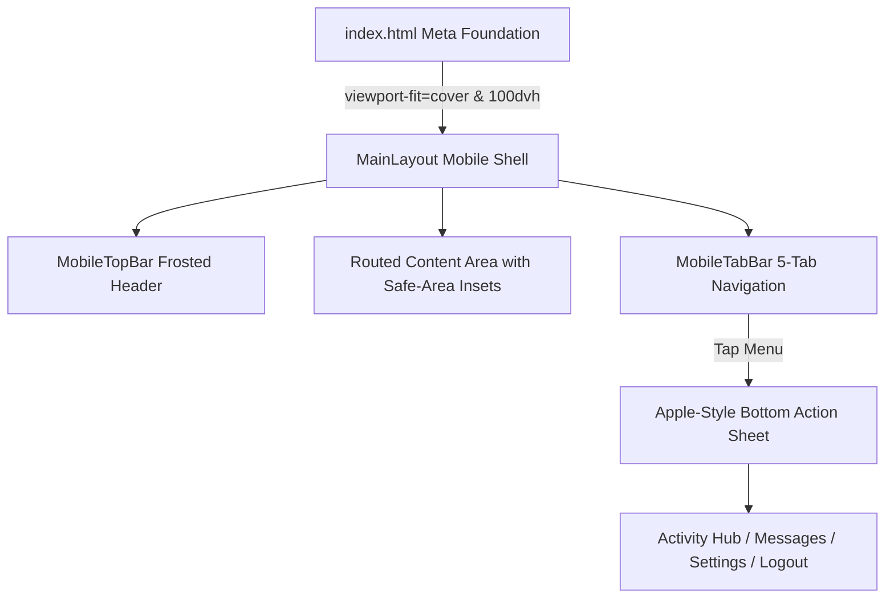

# Native Mobile Interface Redesign — Verification & Architecture Report

> **Engineered with the `mobile-native` skill & Emil Kowalski Design Philosophy**  
> **Status:** ✅ Tested & Verified on 390×844 Mobile Viewport

---

## 📱 Mobile Architecture Overview



---

## 📸 Visual Showcase (390×844 Mobile Viewport)

````carousel

<!-- slide -->

<!-- slide -->

<!-- slide -->

````

---

## 🛠️ Summary of Implementations

| Component / Layer | Details | Skill Rule Applied |
|---|---|---|
| **`index.html`** | `viewport-fit=cover`, `interactive-widget=resizes-content`, scheme-specific `theme-color` (`#ffffff` / `#000000`), `black-translucent` status bar | Safe areas & notch support |
| **`index.css`** | `-webkit-tap-highlight-color: transparent`, `overscroll-behavior: none`, 16px minimum input font-size, `touch-action: manipulation` | No tap delays, zero iOS zoom, no pull-to-refresh hijack |
| **`MobileTopBar.jsx`** | Frosted glass (`blur(24px)`), brand logo, quick universal search trigger, live notification badge, and direct avatar settings link | Safe-area top padding |
| **`MobileTabBar.jsx`** | Fixed bottom navigation (Explore, Feed, Create + squircle, Arena, Menu) with Apple-style bottom action sheet (`MobileActionSheet`) | Thumb-zone ergonomics & safe-area bottom padding |
| **`MainLayout.jsx`** | Migrated to `100dvh` layout units, top padding `calc(58px + safe-area-top)`, bottom padding `calc(72px + safe-area-bottom)` | Dynamic viewport units |
| **`GlobalSearchModal.css`** | Converted to full-screen sheet on mobile (`100dvh`) with `touch-action: pan-y` | Mobile-first search modal |
